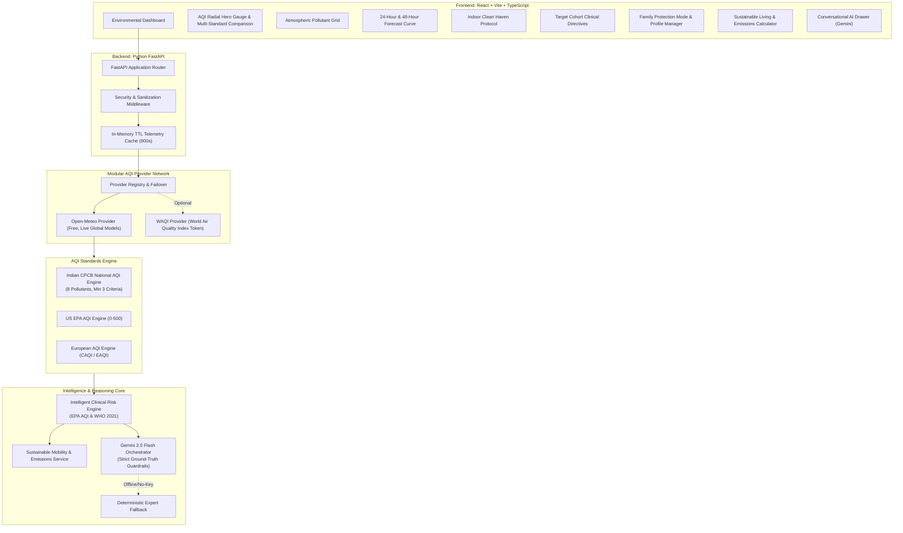

# BreatheWise AI — System Architecture & Design Specification (v0.2.0)

## 1. Architectural Overview

BreatheWise AI is an enterprise-grade urban environmental intelligence platform engineered to translate multi-spectral atmospheric sensor telemetry into proactive, personalized health directives for urban families.

---

## 2. India-First AQI Intelligence & Multi-Standard Architecture

BreatheWise AI explicitly differentiates between air quality standards and **never mixes their breakpoints or presents them as interchangeable**:

### 2.1 Indian CPCB National AQI (NAQI)
- **Framework**: Official Central Pollution Control Board (CPCB) methodology.
- **Criteria Evaluated**: Sub-indices for 8 criteria pollutants (PM10, PM2.5, NO2, O3, CO, SO2, NH3, Pb) using linear breakpoint interpolation:
  $$I_p = I_{LO} + \frac{I_{HI} - I_{LO}}{B_{HI} - B_{LO}} \times (C_p - B_{LO})$$
- **Strict Validation Rule**: At least 3 monitored pollutants must have valid readings, and at least one must be PM2.5 or PM10. If this threshold is not met, CPCB AQI is reported as **Insufficient Data** with a clear explanation, rather than inventing an unverified number.
- **Categories & Breakpoints**:
  - **Good (0-50)**: Minimal health impact (`#10B981`)
  - **Satisfactory (51-100)**: Minor breathing discomfort to sensitive individuals (`#84CC16`)
  - **Moderate (101-200)**: Breathing discomfort to people with asthma, lung, and heart diseases (`#EAB308`)
  - **Poor (201-300)**: Breathing discomfort to most people on prolonged exposure (`#F97316`)
  - **Very Poor (301-400)**: Respiratory illness on prolonged exposure (`#EF4444`)
  - **Severe (401-500)**: Serious health impact even on healthy adults (`#7F1D1D`)

### 2.2 US EPA Air Quality Index
- Standard 0–500 index: Good (0-50), Moderate (51-100), Unhealthy for Sensitive Groups (101-150), Unhealthy (151-200), Very Unhealthy (201-300), Hazardous (301-500).

### 2.3 European Air Quality Index (EAQI)
- Evaluates atmospheric concentrations across five standardized bands: Very Good (0-25), Good (26-50), Moderate (51-75), Poor (76-100), and Very Poor (>100).

---

## 3. Intelligent Recommendation Engine & Multi-Cohort Directives

### 3.1 Transparent 5-Dimension Evidence Architecture
Every recommendation generated by the engine provides 5 distinct dimensions:
1. **Recommended Action**: Clear prescriptive directive.
2. **Physiological Rationale**: Medical and biological mechanism explaining the risk.
3. **Supporting Measurement**: Specific telemetry reading justifying the directive.
4. **Expected Practical Benefit**: Tangible exposure reduction or health protection benefit.
5. **Practical Limitations**: Caveats, equipment requirements, or operational constraints.

### 3.2 Target Cohorts
- **Families with Children**: Pediatric lung development, alveolar particulate burden, school recess protocols.
- **Older Adults (65+)**: Autonomic cardiac strain, arterial plaque instability, blood viscosity mitigation.
- **Students**: Active campus travel safety, classroom indoor air quality, focus and cognition.
- **Daily Commuters**: Roadside exhaust avoidance, transit cabin air filtration, car recirculation mode.
- **Outdoor Workers**: Occupational tidal breathing volume, N95/FFP2 respirator enforcement, indoor rest intervals.
- **General Households**: Cross-ventilation guidelines vs. window sealing and HEPA air purifier speeds.

---

## 4. Sustainable Living & Mobility Module

### 4.1 Methodology & Emissions Factors
Emissions estimates are calculated using standard transport factors (DEFRA / ARAI benchmarks):
- Solo Petrol Car: $170\,\text{g CO}_2\text{e/km}$
- Solo Diesel Car: $155\,\text{g CO}_2\text{e/km}$
- Hybrid Car: $100\,\text{g CO}_2\text{e/km}$
- Electric Car (grid lifecycle): $50\,\text{g CO}_2\text{e/km}$
- Carpooling (2 occupants): $85\,\text{g CO}_2\text{e/p-km}$
- Carpooling (3+ occupants): $57\,\text{g CO}_2\text{e/p-km}$
- Two-Wheeler: $75\,\text{g CO}_2\text{e/km}$
- Public City Bus: $35\,\text{g CO}_2\text{e/p-km}$
- Electric Metro / Train: $22\,\text{g CO}_2\text{e/p-km}$
- Walking / Cycling: $0\,\text{g CO}_2\text{e/km}$

### 4.2 Air Quality Correlation
- When AQI is **Good / Satisfactory** ($\le 75$): Active travel (cycling/walking) is strongly encouraged to combine zero emissions with cardiovascular fitness.
- When AQI is **Poor / Unhealthy** ($> 150$): Active outdoor cycling is flagged with a **Caution** warning due to deep particulate inhalation in traffic; **Electric Metro / Trains** are recommended as enclosed clean-air sanctuaries.

---

## 5. Google Gemini AI Ground-Truth Guardrails

1. **No Hallucinated Stations**: The model is forbidden from inventing fictional sensor stations or synthetic IDs.
2. **Context-Injected Telemetry**: Prompts explicitly supply verified Open-Meteo telemetry and CPCB calculations.
3. **Deterministic Fallback**: When `GEMINI_API_KEY` is not provided, the platform seamlessly falls back to pre-formulated expert clinical responses covering transit, workouts, masks, standards, and ventilation.
4. **Medical Disclaimer**: System enforces that guidance is advisory and educational, never a clinical diagnosis.

---

## 6. Family Protection Mode

- **Demonstration Profiles**: Marcus, Elena, Leo, and Sophia are explicitly badged as **Fictional Demonstration Profiles** to illustrate multi-generational vulnerability responses.
- **Custom Profile Management**: Users can remove demo profiles, create real family members with voluntary health conditions, configure activity preferences, and delete members on demand.
