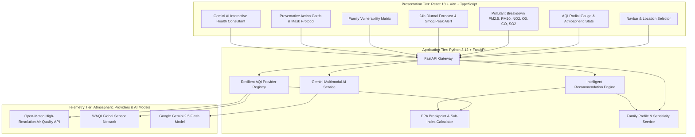

# BreatheWise AI — System Architecture & Technical Specifications

BreatheWise AI is an environmental intelligence and personal respiratory defense platform built for **Challenge 6 – Urban Air Quality Assistant**. It fuses real-time atmospheric sensor data, EPA breakpoint standards, dynamic diurnal forecasts, family vulnerability matrices, and Google Gemini multimodal reasoning to deliver actionable preventative health guidance.

---

## 1. High-Level Architecture

---

## 2. Core Architectural Subsystems

### A. Modular AQI Provider Architecture (`backend/app/providers/`)
- **Abstract Provider Interface (`BaseAQIProvider`)**: Enforces uniform async contracts for `get_current_aqi()`, `get_forecast_aqi()`, and `health_check()`.
- **Open-Meteo Provider (`OpenMeteoAQIProvider`)**: Queries live high-resolution atmospheric modeling and surface sensor feeds without requiring proprietary keys. Collects PM2.5, PM10, NO2, O3, CO, SO2, and weather metrics (temperature, humidity, wind velocity, and bearing).
- **WAQI Provider (`WAQIAQIProvider`)**: Modular secondary provider interfacing with official WAQI stations.
- **Resilient Provider Registry (`ResilientAQIProviderRegistry`)**:
  - Implements an in-memory geo-hashed cache with configurable TTL (default 15 minutes) to eliminate redundant external roundtrips.
  - Multi-tiered automatic failover: If the primary provider times out or encounters network limits, failover immediately transitions to alternate providers or deterministic local baselines.

### B. Standardized AQI Breakpoint Calculator (`backend/app/services/aqi_calculator.py`)
- Employs the official US EPA piecewise linear interpolation equation:
  $$I = \frac{I_{\text{high}} - I_{\text{low}}}{C_{\text{high}} - C_{\text{low}}} \times (C - C_{\text{low}}) + I_{\text{low}}$$
- Calculates sub-indices across all 6 criteria pollutants to identify the exact dominant atmospheric hazard.
- Maps indices into 6 standardized health risk categories:
  1. **Good** (0 – 50)
  2. **Moderate** (51 – 100)
  3. **Unhealthy for Sensitive Groups** (101 – 150)
  4. **Unhealthy** (151 – 200)
  5. **Very Unhealthy** (201 – 300)
  6. **Hazardous** (301 – 500)

### C. Preventative Recommendation & Risk Engine (`backend/app/services/recommendation_engine.py`)
- **Clinical Vulnerability Multiplier**:
  - Scales baseline AQI risk based on physiological risk coefficients:
    - Pediatric airway hyperreactivity (< 12 years): +0.20
    - Geriatric reduced ciliary clearance (> 65 years): +0.20
    - Asthma / Bronchial hyperresponsiveness: +0.35
    - Chronic Obstructive Pulmonary Disease (COPD): +0.45
    - Cardiovascular / Hypertension: +0.30
    - Endurance athlete high-minute ventilation: +0.15
- **4 Pillars of Prevention**:
  1. *Respirator Protocol*: Strict N95 / FFP2 threshold triggers.
  2. *Natural Ventilation Guidance*: Diurnal window opening schedules.
  3. *Active HEPA Scrubbing*: Auto / Medium / Turbo HEPA continuous filtration modes.
  4. *Outdoor Exertion Guidance*: Safe duration caps and transit route selections.

### D. Google Gemini Multimodal Health Consultant (`backend/app/services/gemini_service.py`)
- Leverages the official Google GenAI SDK (`google-genai`).
- Injects real-time atmospheric telemetry and family health profiles directly into the system prompt.
- Formulates context-aware preventative guidance with structured follow-up suggestions and risk flags.
- Built-in graceful degradation: If an API key is missing or network is unreachable, smoothly provides clinical rule-based consultation responses.

### E. Frontend Design System (`frontend/src/`)
- Modern dark-mode environmental aesthetic utilizing deep navy (`#050B14`, `#0A1128`), emerald green (`#10B981`), and cyan (`#06B6D4`) accents.
- Custom SVG radial AQI gauge with animated progress arc and pollutant indicator.
- 24-hour diurnal trajectory chart highlighting smog peak hours and cleanest ventilation windows.
- Family Vulnerability Matrix allowing seamless 1-click persona switching.

