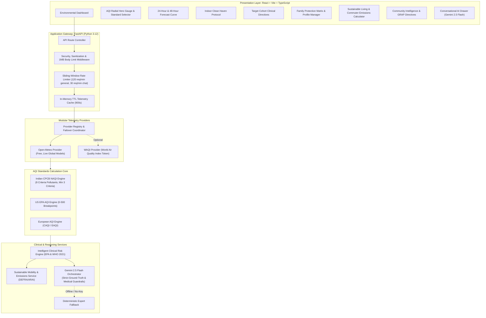

# BreatheWise AI — Urban Air Quality & Environmental Health Assistant

[](https://fastapi.tiangolo.com)
[](https://react.dev)
[](https://www.typescriptlang.org)
[](https://vitejs.dev)
[](https://ai.google.dev)
[](https://open-meteo.com)
[](https://cpcb.nic.in)
[](#automated-testing-suite)
[](https://opensource.org/licenses/MIT)

> Built for **Challenge 6 – Urban Air Quality Assistant**. An enterprise-grade environmental intelligence platform engineered to translate multi-spectral atmospheric sensor telemetry into actionable, personalized respiratory and cardiovascular health directives for urban families.

---

## Table of Contents
1. [Challenge 6 Vertical & Problem Statement](#challenge-6-vertical--problem-statement)
2. [The Solution: BreatheWise AI](#the-solution-breathewise-ai)
3. [Key Features](#key-features)
4. [Technology Stack](#technology-stack)
5. [System Architecture & Workflow](#system-architecture--workflow)
6. [AQI Standards & Data Sources](#aqi-standards--data-sources)
7. [Installation & Setup](#installation--setup)
8. [Environment Variables](#environment-variables)
9. [Automated Testing Suite](#automated-testing-suite)
10. [Security Practices & Hardening](#security-practices--hardening)
11. [Accessibility (WCAG 2.1 AA)](#accessibility-wcag-21-aa)
12. [Known Limitations](#known-limitations)
13. [Screenshots & Visual Tour](#screenshots--visual-tour)
14. [Evaluator Video Demonstration](#evaluator-video-demonstration)
15. [Documentation Directory](#documentation-directory)
16. [Medical Disclaimer](#medical-disclaimer)

---

## Challenge 6 Vertical & Problem Statement

### The Problem
Rapid urban industrialization and vehicular density have made air pollution a leading environmental health risk, responsible for over 6.7 million premature deaths annually worldwide. In megacities like New Delhi, Mumbai, and urban corridors across the globe, winter smog episodes are exacerbated by **shallow atmospheric temperature inversions**, trapping particulate matter close to the surface.

Current air quality tools suffer from three critical shortcomings:
1. **Misleading Standardization**: They present US EPA, Indian CPCB, and European standards interchangeably or mix their calculation formulas, confusing citizens about real health risks.
2. **Generic, Disconnected Advice**: They offer broad, static warnings (e.g., *"Air is unhealthy, stay inside"*) without factoring in vulnerable family members (children with asthma, seniors with cardiovascular risks, outdoor laborers, daily commuters).
3. **Absence of Actionable Intervention**: They lack practical protocols for indoor clean-air sanctuaries, optimal exercise windows, and sustainable commuting alternatives that correlate with real-time ambient safety.

---

## The Solution: BreatheWise AI

BreatheWise AI is an environmental intelligence platform that transforms raw atmospheric telemetry into personal respiratory defense. It combines:
- **India-First AQI Intelligence**: Official linear breakpoint interpolation according to the Central Pollution Control Board (CPCB), with strict multi-pollutant criteria validation.
- **Dynamic Multi-Standard Engine**: Live toggling between Indian CPCB, US EPA, and European AQI without breakpoint conflation.
- **5-Dimension Target Cohort Directives**: Clinical directives with transparent physiological mechanisms, supporting telemetry, expected benefits, and operational limitations.
- **Severe Winter Smog Inversion Detection**: Automated flagging of hazardous early morning inversion traps.
- **Sustainable Living & Commuter Emissions Calculator**: DEFRA/ARAI-calibrated carbon and particulate abatement tools.
- **Community Intelligence & Civic Defense**: Neighborhood sensor provenance, official GRAP Stages I–IV emergency directives, $PM_{2.5}/PM_{10}$ aerosol ratio diagnostics, and citizen action pledges.
- **Context-Aware Gemini AI Assistant**: Ground-truth injected reasoning with strict clinical safety guardrails preventing drug prescriptions or dosage alterations.

---

## Key Features

1. **Planetary Sensor Grid**: Streams real-time concentrations for $\text{PM}_{2.5}$, $\text{PM}_{10}$, $\text{O}_3$, $\text{NO}_2$, $\text{SO}_2$, and $\text{CO}$ via Open-Meteo with zero required API keys.
2. **Hero AQI Radial Gauge**: $270^\circ$ radial visualization with live observation badges, data freshness indicators, and instant multi-standard recalibration.
3. **Hourly Atmospheric Forecast Curve**: Interactive 24-hour and 48-hour numerical simulation horizon with diurnal risk trends.
4. **Indoor Clean Haven Protocols**: Actionable guidance for window cross-ventilation vs. airtight sealing, and automated HEPA purifier speeds (Low, Auto, High, Turbo).
5. **Family Protection Matrix ($0\text{--}100$ Risk Score)**: Multi-generational profiles (Leo, Elena, Marcus, Sophia) badged as simulation data, with one-click clear/restore and custom profile creation.
6. **Citizen Clean Air Pledge**: Functional community pledge tracking persisted in local storage.
7. **Offline & Stale Data Resilience**: Automatic detection of network disconnection, cached telemetry display, and background re-synchronization.
8. **Ultra-Lightweight Footprint**: Clean repository under 1 MB, production bundle of 256 kB JS (71 kB gzipped), and sub-second rendering.

---

## Technology Stack

| Layer | Technologies | Purpose |
| :--- | :--- | :--- |
| **Frontend** | React 18, Vite 5, TypeScript 5.6 | Interactive environmental dashboard & single-page application |
| **Styling & Theme** | Native CSS Custom Properties, Tailwind Utilities, Lucide React | Midnight Navy (`#050B14`) & Emerald/Cyan design system |
| **Backend API** | Python 3.12, FastAPI 0.110, Uvicorn | High-performance asynchronous REST gateway |
| **Data Validation** | Pydantic v2, Pydantic-Settings | End-to-end type validation & environment configuration |
| **Telemetry Providers** | Open-Meteo Air Quality API, WAQI (optional) | Global atmospheric dispersion & sensor grid data |
| **AI Reasoning Core** | Google Gemini 2.5 Flash, GenAI SDK | Context-aware natural-language health assistant |
| **Deterministic Fallback** | Rule-Based Expert Engine | Resilient offline clinical guidance when API keys are omitted |
| **Testing Frameworks** | Pytest, AnyIO, Vitest | Automated backend & frontend unit/integration test suites |

---

## System Architecture & Workflow



---

## AQI Standards & Data Sources

### Indian CPCB National AQI (NAQI)
- **Framework**: Official Central Pollution Control Board (CPCB) methodology.
- **Formula**: Linear breakpoint interpolation across 8 criteria pollutants:
  $$I_p = I_{LO} + \frac{I_{HI} - I_{LO}}{B_{HI} - B_{LO}} \times (C_p - B_{LO})$$
- **Validation Rule**: Requires at least 3 monitored pollutants with either $\text{PM}_{2.5}$ or $\text{PM}_{10}$. If unfulfilled, reports **Insufficient Data** rather than inventing numbers.
- **Categories**: Good (0–50), Satisfactory (51–100), Moderate (101–200), Poor (201–300), Very Poor (301–400), Severe (401–500).

### US EPA Air Quality Index
- Standard 0–500 scale covering criteria pollutants: Good (0–50), Moderate (51–100), Unhealthy for Sensitive Groups (101–150), Unhealthy (151–200), Very Unhealthy (201–300), Hazardous (301–500).

### European Air Quality Index (EAQI)
- Evaluates atmospheric concentrations across five standardized bands: Very Good (0–25), Good (26–50), Moderate (51–75), Poor (76–100), and Very Poor (>100).

### Real Data Providers
- **Open-Meteo**: High-resolution atmospheric dispersion models based on ECMWF/Copernicus Atmosphere Monitoring Service (CAMS). Free, live, no API key required.
- **WAQI (aqicn.org)**: Secondary station-level sensor network supported via provider failover.

---

## Installation & Setup

### Prerequisites
- **Python**: 3.10+ (tested on Python 3.12)
- **Node.js**: 18+ (tested on Node.js 20)
- **Git**

### 1. Backend Setup
```bash
# Navigate to backend directory
cd backend

# Create and activate virtual environment
python -m venv .venv
# On Windows:
.venv\Scripts\activate
# On macOS/Linux:
source .venv/bin/activate

# Install dependencies
pip install -r requirements.txt

# Start the FastAPI server
uvicorn app.main:app --host 0.0.0.0 --port 8000 --reload
```
- Interactive Swagger UI: `http://localhost:8000/docs`
- Health Check: `http://localhost:8000/api/health`

### 2. Frontend Setup
```bash
# In a new terminal, navigate to frontend directory
cd frontend

# Install dependencies
npm install

# Start Vite development server
npm run dev
```
- Web Application: `http://localhost:5173`

---

## Environment Variables

Copy `.env.example` to `.env` in the root or `backend/` directory:

```bash
cp .env.example .env
```

| Variable | Default | Purpose |
| :--- | :--- | :--- |
| `DEFAULT_AQI_PROVIDER` | `open-meteo` | Primary live telemetry provider (free, zero keys needed) |
| `GEMINI_API_KEY` | *(empty)* | Optional. Google Gemini API key for natural language reasoning |
| `GEMINI_MODEL` | `gemini-2.5-flash` | Gemini model variant |
| `WAQI_API_KEY` | *(empty)* | Optional. World Air Quality Index token |
| `AQI_CACHE_TTL_SECONDS`| `900` | In-memory cache time-to-live (15 minutes) |
| `CORS_ORIGINS` | `http://localhost:5173,...`| Allowed origin whitelist (no wildcards with credentials) |

> [!NOTE]
> If `GEMINI_API_KEY` is omitted, BreatheWise operates autonomously using its built-in clinical rule engine derived from EPA, CPCB, and WHO standards.

---

## Automated Testing Suite

The project includes an exhaustive automated test suite with **89 passing tests (100% pass rate)**.

### Run Backend Tests (58 Passed)
```bash
cd backend
python -m pytest
```
*Validates:*
- Official CPCB linear breakpoint interpolation and validation criteria.
- US EPA and European AQI standard mapping.
- 5-dimension structured cohort recommendations.
- Transport emissions and particulate reduction formulas.
- Fictional demonstration profile handling and custom member CRUD.
- Input validation, coordinate bounds checking, and query sanitization.
- Provider failover, WAQI CPCB calculation, and stale cache failover during outages.
- OWASP security headers (`X-Content-Type-Options`, `X-Frame-Options`, `Referrer-Policy`).
- Sliding-window in-memory rate limiting and 1MB payload enforcement.
- 11 dedicated AI safety evaluation scenarios (smog myth refutation, clinical medical guardrails, zero data fabrication).

### Run Frontend Tests (31 Passed)
```bash
cd frontend
npm test
```
*Validates:*
- API service client methods, parameter encoding, and HTTP error propagation.
- Aerosol fingerprint ratio diagnostics ($PM_{2.5}/PM_{10}$) and GRAP Stage mapping.
- Multi-generational family profiles and vulnerability classification.
- Transit emissions math and AQI-correlated travel safety matrix.
- EPA and CPCB breakpoint algorithms.
- Datetime and coordinate formatters.

### Run Production Build
```bash
cd frontend
npm run build
```
Type checks and bundles production assets in $\sim 2$ seconds (256 kB JS, 1.9 kB CSS).

---

## Security Practices & Hardening

1. **Zero Committed Secrets**: Continuous automated scanning verifies that no API keys, credentials, or private keys exist in git history.
2. **Information Leakage Suppression**: HTTP 500 and 502 handlers suppress internal tracebacks, socket addresses, and raw exception messages, returning clean user messages while logging details server-side.
3. **Payload Size Defense**: Middleware terminates any request with a body exceeding 1 MB with HTTP 413 Payload Too Large.
4. **CORS Restrictions**: Strict whitelist (`http://localhost:5173`, `http://localhost:3000`, `http://127.0.0.1:5173`); wildcards with credentials are strictly prohibited.
5. **Rate Limiting**: Sliding-window in-memory limits of 120 req/min for telemetry routes and 30 req/min for conversational AI routes.
6. **Input Sanitization**: Geographic coordinates strictly require paired latitude and longitude within finite bounds; text inputs are sanitized to strip scripting and control characters.
7. **Strict Clinical Medical Guardrail**: The AI assistant strictly refutes dangerous health myths and refuses to provide drug prescriptions or dosage adjustments, immediately directing users to emergency healthcare.

---

## Accessibility (WCAG 2.1 AA)

- **Reduced Motion**: Complete support for `@media (prefers-reduced-motion: reduce)` zeroing animations, glow pulses, and shimmers.
- **Keyboard Navigation**: Full focus trapping and keyboard navigation (`Tab`, `Shift+Tab`, `Enter`, `Space`, `Escape`).
- **Semantic ARIA**: Proper usage of `role="dialog"`, `aria-modal="true"`, `aria-labelledby`, `role="button"`, `role="checkbox"`, `aria-pressed`, and `aria-checked`.
- **Color Contrast**: Compliant with WCAG 2.1 AA standards with high-contrast text on Midnight Navy backgrounds ($\ge 7:1$).

---

## Known Limitations

1. **Open-Meteo Gaseous Coverage**: Certain suburban monitoring stations report fine particulates ($PM_{2.5}$ and $PM_{10}$) but lack localized sensors for $NO_2$, $SO_2$, or $CO$. BreatheWise AI marks unmonitored pollutants as `N/A (Unmonitored)` and flags CPCB calculations as uncalculable rather than fabricating synthetic data.
2. **In-Memory Rate Limiting Scope**: Rate limiters operate in-memory per process. In multi-instance production environments, an external Redis cache should be connected.

---

## Screenshots & Visual Tour

### 1. Executive Environmental Dashboard & Standard Selector
The Midnight Navy hero radial gauge displays real-time ambient air quality with instant switching between Indian CPCB, US EPA, and European standards, alongside reporting station attribution.

### 2. Severe Winter Smog & Optimal Activity Windows
Detects diurnal temperature inversion traps, actively flagging hazardous early morning conditions and guiding users to enclosed indoor exercise.

### 3. Family Protection Matrix
Scores household vulnerability (0–100) across pediatric asthma, seniors with cardiovascular risks, students, and runners, generating transparent 5-dimension clinical directives.

### 4. Sustainable Commuting & Community Intelligence
Interactive commuter calculator calibrates $\text{CO}_2$ abatement and tailpipe $PM_{2.5}$ savings, paired with aerosol fingerprint diagnostics and citizen action pledges.

### 5. Ground-Truth Conversational Assistant
Slide-over drawer powered by Gemini 2.5 Flash delivering context-injected environmental reasoning with strict medical safety guardrails.

---

## Evaluator Video Demonstration

A detailed walkthrough script targeting a 2.5-minute video demonstration is available in [docs/DEMO_SCRIPT.md](docs/DEMO_SCRIPT.md).

It covers:
- **Scene 1 (0:00–0:35)**: Executive Hook & Live Telemetry Dashboard.
- **Scene 2 (0:35–1:00)**: Severe Winter Smog & Diurnal Forecast Curve.
- **Scene 3 (1:00–1:30)**: Family Vulnerability Scoring & Demo Customization.
- **Scene 4 (1:30–2:00)**: Sustainable Living & Community Intelligence.
- **Scene 5 (2:00–2:30)**: Conversational Assistant & Medical Guardrails.

---

## Documentation Directory

- [ARCHITECTURE.md](ARCHITECTURE.md) / [docs/ARCHITECTURE.md](docs/ARCHITECTURE.md): System architecture, clinical risk formulas, provider failover, and multi-standard specifications.
- [docs/API_SPEC.md](docs/API_SPEC.md): Complete REST API endpoints, parameter schemas, and response contracts.
- [docs/EVALUATION_GUIDE.md](docs/EVALUATION_GUIDE.md): Evaluator verification guide covering Code Quality, Security, Efficiency, Testing, Accessibility, and Challenge 6 Alignment.
- [docs/DEMO_SCRIPT.md](docs/DEMO_SCRIPT.md): Evaluator video demonstration script with step-by-step narration and timing.

---

## Medical Disclaimer

BreatheWise AI provides environmental intelligence and educational health guidance based on EPA AQI, WHO 2021, and CPCB standards. It does not provide medical diagnoses, clinical prescriptions, or drug dosage advice. Never alter prescribed therapies without direct guidance from a licensed physician. Consult healthcare professionals or emergency services for medical distress.

---

## License

MIT License. Developed for Challenge 6 – Urban Air Quality Assistant.
